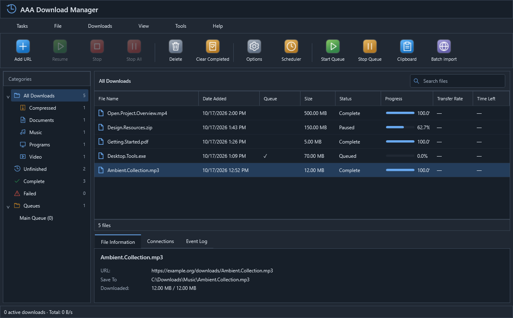

# AAA Download Manager

[](https://github.com/withcerAi/AAA-Download-Manager/actions/workflows/windows-build.yml)

A native Windows download manager built with C# / .NET 10 and WPF. The interface defaults to English and supports Persian, including right-to-left layouts. Independent JSON language files allow additional translations.



*English interface in the dark theme, shown with sample download entries.*

> **Preview software.** Read the [important risk and liability notice](DISCLAIMER.md) and the [complete terms](TERMS.md) before installing or using it. The software is provided as is, subject to mandatory legal protections. Maintain backups and verify downloaded files before opening them.

## Downloads and installation

**[Download the Windows x64 installer — 0.5.6 Preview](https://github.com/withcerAi/AAA-Download-Manager/releases/download/v0.5.6-preview/AAA-Download-Manager-0.5.6-Setup-x64.exe)** · [Release notes and SHA-256 checksum](https://github.com/withcerAi/AAA-Download-Manager/releases/tag/v0.5.6-preview)

This preview installer uses a personal **self-signed** certificate. It is not CA-trusted and Windows may still show publisher or SmartScreen warnings. See the [code signing policy](CODE_SIGNING.md).

The Windows x64 installer is named `AAA-Download-Manager-0.5.6-Setup-x64.exe`. Installers are distributed through GitHub Releases and are not stored in Git source history. This full package includes the .NET runtime, media tools and browser extension files. Users do not need a separate .NET, Python, Node.js or WebView2 installation. Review and accept the English terms on the installer license page. To install unattended after reviewing and authorizing the terms, supply `/ACCEPTTERMS=1`; silent installation without that argument is rejected.

The package remains a preview. Server, browser and operating-system support determine which operations are available. No download speed, file authenticity, safe content or successful recovery is guaranteed.

## Features

- HTTP/HTTPS multipart transfers where servers support safe byte ranges, pause/resume and configurable transfer limits.
- Download queues, concurrency limits, scheduling and configurable completion actions.
- Clipboard import extracts download links from copied text and HTML into separate review rows. Batch links adds file import and numbered URL patterns. Additional pastes preserve the existing rows and selections, skip duplicates, and never display unrelated clipboard text. Cancellable server-header checks show names, sizes and availability before adding downloads.
- Chrome, Edge and Firefox native browser handoff, with a single ON/OFF toolbar action.
- English/LTR and Persian/RTL, independent translation files, five palettes and light/dark/system appearance.
- Shared configurable temporary storage, persistent history and themed file-removal choices.
- FTP/FTPS and supported HLS/DASH media workflows, subject to source and tool limitations.

This project does not claim complete parity with another product. Test runners are included under `tests`; local execution artifacts and private development audit logs are excluded.

## Category folders

Settings > Save To lists category destinations directly. Select a category and choose its folder, or use **Use default folder** to clear the override. An empty destination uses the main download folder; custom categories start with no folder override. Absolute paths can target another drive, and existing relative paths remain relative to the main download folder. Already completed files are not moved.

**Add category** opens a form for a name, file extensions and an optional folder. Edit or double-click an existing category to change it. Extensions are normalized, and conflicting assignments are identified before saving. Custom categories also appear in the main sidebar. Changes take effect after Apply or OK.

## Browser extensions

Load the `browser-extension/chromium` folder unpacked in Chrome or Edge developer mode. The installer can register the current user's native messaging bridge; manual registration is available under Tools > Browser Integration. Keep the existing extension ID when upgrading.

For Firefox, the supplied XPI is unsigned and intended for temporary developer loading through `about:debugging`. Permanent installation in standard Firefox requires Mozilla signing. No browser store publication or signing is implied.

The toolbar icon switches capture ON or OFF. ON requires an available native bridge when enabled. With capture OFF, downloads follow the browser's normal path. Compatible navigation response headers can identify a file before desktop approval. The desktop uses HEAD-only checks for eligible GET links when needed and does not replay POST requests to inspect them or sniff file content.

## About and legal documents

Help > About shows the current application version and opens the complete English terms and third-party notices. [TERMS.md](TERMS.md) is the GitHub-readable version of [the installer text](legal/TERMS-OF-USE.txt). First-party source code is licensed under the [MIT License](LICENSE). Risk notices do not restrict rights granted by MIT or applicable third-party licenses. FFmpeg retains its LGPL license and notices in `media-tools`; the Inno Setup Farsi translation retains its original attribution.

AAA Download Manager is an independent project. Product and browser names identify compatibility and do not imply affiliation or endorsement. Applying this product name does not establish trademark registration.

## Build and testing

GitHub Actions builds and tests the project on a GitHub-hosted Windows runner for pushes to `main`, pull requests and manual runs. Successful runs provide an unsigned, self-contained Windows x64 application under **Artifacts**. It includes the browser host and extension sources; the optional FFmpeg runtime and installer are not included. The artifact records its source commit and build run. This workflow does not perform code signing or publish a GitHub Release.

Use the .NET 10 SDK on Windows:

```powershell
dotnet publish src/DownloadManager.Desktop/DownloadManager.Desktop.csproj -c Release -r win-x64 --self-contained true -o release/DownloadManager-0.5.6-preview --configfile NuGet.Config
```

`installer/build.ps1` publishes the desktop and native host and compiles the Inno Setup installer. `browser-extension/build.py --version 0.5.3` synchronizes the canonical extension source.

The source repository intentionally excludes FFmpeg executables and DLLs. Ordinary HTTP/FTP downloads and the desktop build do not require them. Before building a full media-enabled installer, obtain the LGPL shared Windows x64 build documented in [media-tools/README.md](media-tools/README.md) and place its runtime files in `media-tools/bin`. Never commit these binaries, signing keys or local profiles.

Give each test run a fresh artifact directory. Local HTTP fixtures use loopback and are disposed by the runners. Browser tests use isolated profiles; operating-system power actions use fake executors in automated tests.

```powershell
dotnet run --project tests/DownloadManager.Core.Tests -c Release -- artifacts/core-unique
dotnet run --project tests/DownloadManager.Integration.Tests -c Release -- artifacts/integration-unique
dotnet run --project tests/DownloadManager.Desktop.Tests -c Release -- artifacts/ui-unique
node tests/extension-tests.cjs
```

For upgrade compatibility, internal executable names, the existing application-data directory, installer identity and native messaging IDs retain their previous technical identifiers. Saved settings and download history are not renamed or discarded when the product is rebranded.

## Code signing policy

See [CODE_SIGNING.md](CODE_SIGNING.md) for current status and release requirements. Publishing open source does not mean that this project has been accepted by a signing provider. See [SECURITY.md](SECURITY.md) before reporting vulnerabilities or sharing diagnostics.
